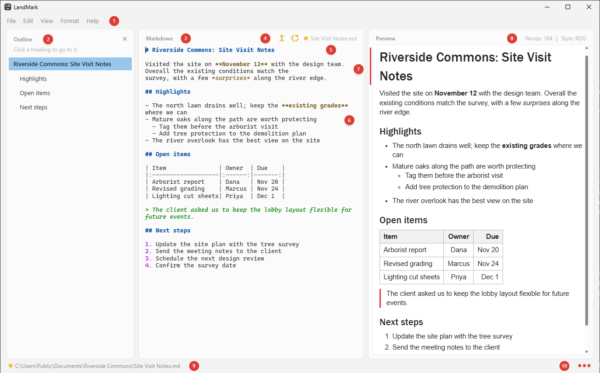
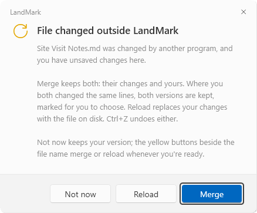

<p align="center">
  
</p>

<h1 align="center">LandMark</h1>

<p align="center">
  <b>Markdown, made presentable.</b><br>
  Write in plain text, then send it as an email, a Word document or a PDF, styled to the RDG brand.
</p>

<p align="center">
  <br>
  <sub>RDG Planning &amp; Design</sub>
</p>

---

LandMark is a small Windows app for reading and writing Markdown, the plain-text format with `#` for headings and `**`
for bold, and for getting it into emails and Word documents without losing the formatting. You type on the left and
see the finished document on the right, in the RDG style.

| | |
|---|---|
| **Copy for Email** | Paste into Outlook or Gmail with headings, lists, tables and links intact. |
| **Word document** | Real Word styles (Heading 1, List Paragraph, Quote), so it stays easy to edit. |
| **PDF document** | Exactly what the preview shows, on US Letter pages, numbered "Page n of N". |
| **Plain text** | Symbols removed and headings underlined, for anywhere formatting won't go. |

> A branded version of this guide for sharing and printing is in
> [`docs/LandMark-User-Guide.html`](docs/LandMark-User-Guide.html). GitHub shows that file as code, so download it
> and open it in a browser.

## Contents

1. [Getting Started](#getting-started)
2. [The Window at a Glance](#the-window-at-a-glance)
3. [Writing Markdown](#writing-markdown)
4. [Views and Getting Around](#views-and-getting-around)
5. [Find and Replace](#find-and-replace)
6. [Email, Word, PDF and Plain Text](#email-word-pdf-and-plain-text)
7. [Links and Images](#links-and-images)
8. [Styles and the App Theme](#styles-and-the-app-theme)
9. [When Someone Else Changes the File](#when-someone-else-changes-the-file)
10. [Symbols and Indicators](#symbols-and-indicators)
11. [Messages](#messages)
12. [Keyboard Shortcuts](#keyboard-shortcuts)
13. [Settings and Other PCs](#settings-and-other-pcs)
14. [For Developers](#for-developers)
15. [License](#license)

## Getting Started

### What you need

- **LandMark.exe.** One file of about 1.8 MB. Keep it in a folder you won't move, such as `Documents\Apps`, and run it
  from there.
- **Windows 10 or 11 (64-bit) with the .NET 10 Desktop Runtime.** If the runtime is missing, Windows says so when you
  start LandMark and links to the free download (https://dotnet.microsoft.com/download/dotnet/10.0).
- **The Microsoft Edge WebView2 Runtime** for the preview and PDF export. It comes with Windows 11 and with Microsoft
  Edge on Windows 10. If it's missing, the Preview pane says where to get it.

### Opening a document

- **File › Open** (<kbd>Ctrl</kbd>+<kbd>O</kbd>), or drag a `.md` file onto the window.
- **File › Open Recent** lists the last 7 files you opened or saved, newest first.
- Double-click a `.md` file in File Explorer, once you've set that up (see below).
- Or start a new document (<kbd>Ctrl</kbd>+<kbd>N</kbd>) and type or paste Markdown into the editor.

A file that's already open in a LandMark window is never opened twice. Opening it again brings the window that has it
to the front, and opening the window's own file just says *"… is already open"* in the status bar. Any other file
opens in a window of its own.

### Saving

**File › Save** (<kbd>Ctrl</kbd>+<kbd>S</kbd>) writes the Markdown back to the file, and **Save As**
(<kbd>Ctrl</kbd>+<kbd>Shift</kbd>+<kbd>S</kbd>) saves a copy somewhere else. A yellow dot
 beside the file name means there are unsaved
changes. It goes away when you save, or when you undo back to the saved text. If you close a window with unsaved
changes, LandMark asks first.

### Open .md files by double-clicking

Choose **Help › Open .md Files with LandMark…**. This registers LandMark for `.md`, `.markdown`, `.mdown` and `.mkd`
files for your account only, with no admin rights needed.

- If no other app has claimed those file types, LandMark becomes their default straight away.
- Otherwise LandMark offers to open **Settings › Apps › Default apps**. Windows only lets you change a default
  yourself, so select `.md` there and choose LandMark.

> **Tip:** Do this from `LandMark.exe` in the folder where you'll keep it. If you move the exe later, run it once from
> the new folder and the registration follows it.

## The Window at a Glance

Here's a document with the Outline open, an unsaved edit, and a change made by another program waiting to be brought in.



1. **Menus.** File, Edit, View, Format and Help. Every command shows its keyboard shortcut.
2. **Outline** (<kbd>Ctrl</kbd>+<kbd>Shift</kbd>+<kbd>O</kbd>). The document's headings; click one to go to it. The
   heading you're working under is highlighted.
3. **Markdown editor.** Where you type. Double-click the word *Markdown* to show only the editor; double-click again
   for both panes.
4. **Merge and reload buttons** 
   . Shown only when another program has changed the
   file. See [When Someone Else Changes the File](#when-someone-else-changes-the-file).
5. **Unsaved dot and file name** . The dot means
   there are changes you haven't saved. Point at the name to see the full path.
6. **Syntax colors.** Headings, lists, bold, code, links and quotes each get their own color, so the Markdown is easy
   to scan.
7. **Line marker** . The red bar beside the
   preview shows where the editor's cursor line is in the document.
8. **Preview**, with the word count and the document's style. Double-click *Preview* to show only the preview.
9. **Status bar.** The file's full path, with its own unsaved dot. Right-click the path to copy it. Short confirmations
   appear here for a few seconds.
10. **RDG ellipsis.** The RDG Planning & Design mark.

The preview always has a white page, even in the Dark theme, because it shows what your readers will see.

## Writing Markdown

Markdown is ordinary text with a few symbols for formatting. LandMark shows the result as you type. Press
<kbd>F1</kbd> (**View › Markdown Cheat Sheet**) for a panel that explains each symbol. Click an example in the panel to
insert it: selected text is wrapped in it, and headings, lists and quotes apply to the current or selected lines.

| Type this | To get |
|---|---|
| `# Heading 1`<br>`## Heading 2`<br>`### Heading 3` | Headings, from the title down. Each extra `#` is one level smaller, down to `######`. Put a space after the `#`. |
| `**bold**` | **Bold** (or `__two underscores__`) |
| `*italic*` | *Italic* (or `_one underscore_`) |
| `***bold italic***` | ***Bold and italic*** |
| `~~strikethrough~~` | ~~Crossed-out text~~ |
| `` `code` `` | Code in a monospace font. Use the backtick (left of <kbd>1</kbd>), not the apostrophe. |
| `- item` | A bullet list. A dash (or `*` or `+`) and a space at the start of each line. |
| `1. item` | A numbered list, counting up from the first number. |
| `  - nested item` | Indent two or more spaces under an item to nest a list inside it. |
| `- [ ] to do`<br>`- [x] done` | A checklist: an open box, and a checked one. |
| `[text](https://…)` | A link: the words to show, then the address. A web address on its own becomes a link too. |
| `` | An image. The description is shown wherever the image can't be. |
| `> quoted text` | A block quote, indented with a colored bar. |
| ` ``` ` on the lines before and after | A block of code. |
| `---` | A horizontal rule, on a line of its own with a blank line above. Directly under text, it makes that text a Heading 2 instead. |
| `\| A \| B \|`<br>`\|---\|---\|`<br>`\| 1 \| 2 \|` | A table. Pipes separate the columns and the dashes mark the header row. In the dashes row, `:---` aligns left, `:---:` centers and `---:` aligns right. |
| (a blank line) | A new paragraph. A single line break inside a paragraph is joined into one line. |
| two spaces at the end of a line | A line break without starting a new paragraph (a `\` at the end works too). |
| `\*` | A backslash before a symbol shows the symbol itself instead of formatting. |

HTML tags typed into the text are left out, except `<br>` for a line break.

## Views and Getting Around

| Feature | How | What it does |
|---|---|---|
| **Editor Only / Split / Preview Only** | <kbd>Ctrl</kbd>+<kbd>1</kbd> / <kbd>2</kbd> / <kbd>3</kbd> | Show one pane or both. Double-clicking a pane's title does the same. |
| **Panes in step** | Split view | The preview follows the editor, keeping your cursor line at the same height in both, and scrolling the preview scrolls the editor. |
| **Click in the preview** | Click a word or select text | Selects the same words in the Markdown, so you can go straight to the place you want to change. |
| **Outline** | <kbd>Ctrl</kbd>+<kbd>Shift</kbd>+<kbd>O</kbd> | Lists the headings on the left, indented by level. Click one, or select it and press <kbd>Enter</kbd>, to go to it. |
| **Markdown Cheat Sheet** | <kbd>F1</kbd> | Explains each symbol in a panel on the right. Click an example to insert it. |
| **Word Wrap** | <kbd>Alt</kbd>+<kbd>Z</kbd> | Wraps long lines in the editor to fit the pane, or lets them run off to the right. |
| **Syntax Colors** | View › Syntax Colors | Colors the Markdown like code in a programming editor. The colors follow the app theme. On by default. |
| **Zoom** | <kbd>Ctrl</kbd>+<kbd>+</kbd> / <kbd>Ctrl</kbd>+<kbd>-</kbd> / <kbd>Ctrl</kbd>+<kbd>0</kbd> | Makes the editor text bigger or smaller, or back to normal. |

## Find and Replace

Press <kbd>Ctrl</kbd>+<kbd>F</kbd> to find, or <kbd>Ctrl</kbd>+<kbd>H</kbd> to find and replace. It works from either
pane and in any view.

- The bar opens above the editor, or above the preview in Preview Only. It starts with any text you've selected, and
  goes straight to the first match.
- The count shows where you are, such as *1 of 28*. *? of 28* means there are matches but none is selected, and
  *No results* means there are none.
- The current match is selected in the editor. In the preview, every match is highlighted in yellow and the current
  one in orange.
- <kbd>Enter</kbd> or <kbd>F3</kbd> goes to the next match, and <kbd>Shift</kbd>+<kbd>Enter</kbd> or
  <kbd>Shift</kbd>+<kbd>F3</kbd> to the previous one. Searching wraps around, and the status bar says when it does.
- **Aa** (<kbd>Alt</kbd>+<kbd>C</kbd>) matches upper and lower case exactly, and **<u>ab</u>**
  (<kbd>Alt</kbd>+<kbd>W</kbd>) finds whole words only.
- The arrow at the left shows or hides the Replace row. **Replace** changes the current match and moves to the next,
  and **Replace All** (<kbd>Ctrl</kbd>+<kbd>Alt</kbd>+<kbd>Enter</kbd>) changes every match at once.
  <kbd>Ctrl</kbd>+<kbd>Z</kbd> undoes a Replace All in one step.
- <kbd>Esc</kbd> closes the bar.

Find searches the Markdown, so a search for a link's address finds it even though the preview only shows the link's
words.

## Email, Word, PDF and Plain Text

Everything you send uses the document's [style](#styles-and-the-app-theme): the fonts, sizes and colors you see in the
preview.

| Command | Shortcut | What you get |
|---|---|---|
| **Edit › Copy for Email** | <kbd>Ctrl</kbd>+<kbd>Shift</kbd>+<kbd>C</kbd> | The formatted document on the clipboard, ready to paste into a new message. The formatting is built in, so Outlook and Gmail keep it, and programs that only take text get a plain version. |
| **Edit › Copy as Plain Text** | <kbd>Ctrl</kbd>+<kbd>Alt</kbd>+<kbd>C</kbd> | Text without the Markdown symbols. Headings are underlined, and link addresses are kept in parentheses. |
| **File › Export › PDF Document** | <kbd>Ctrl</kbd>+<kbd>E</kbd> | The preview printed to US Letter pages, with "Page n of N" at the bottom. It looks exactly like the preview, links can be clicked and text can be selected. |
| **File › Export › Word Document** | | A `.docx` that uses Word's own styles (Heading 1–6, List Paragraph, Quote, Hyperlink), so it's easy to keep editing in Word. |
| **File › Export › Plain Text** | | The plain-text version, saved as a `.txt` file. |

**Format › Page Margins** sets the margins for PDF and Word exports: **Wide** (1") or **Narrow** (0.25") on every
side. Narrow is fine on screen, but some printers can't print that close to the edge.

> **Images in exports:** Pictures from your PC appear in the preview and the PDF. In Copy for Email, Word and
> plain-text exports they become `[Image: description]`, because a path on your PC means nothing to the recipient.

## Links and Images

### Clicking links in the preview

- Web and email links open in your browser or email app.
- Links to other Markdown files open in LandMark. Addresses that don't start with a drive or `https://` are relative to
  the document's folder, so save a new document first.
- Other files and folders open in their usual Windows program.
- For safety, programs (`.exe`, `.bat`, `.ps1` and the like) are never started from a link.
- If a link's target doesn't exist, the status bar says so.

### Pictures from your PC

Write `` to show a picture. A path like that one is relative to the document's
folder, so a new document needs saving first. A full path such as `C:\Projects\photo.jpg` works too.

## Styles and the App Theme

Markdown has no fonts or colors of its own. Those come from the document's **style**, which is used by the preview,
Copy for Email, PDF and Word export. The Preview header shows the current one, such as *Style: RDG*.

### Built-in styles

| Style | Look |
|---|---|
| **RDG** (default) | Franklin Gothic in True Black, RDG Red accents on quotes and rules, from the April 2026 Brand Guidelines. |
| **Classic** | Calibri with Word-style blue headings. |
| **Neutral** | Black and gray only; safe for any business email. |

### The Format menu

- **Pick a style** for the current document. LandMark remembers it for that file.
- **Set Current Style as Default** uses it for new documents and for files without a style of their own.
- **Customize Styles…** opens the Styles window (below).
- **Page Margins**: Wide or Narrow, for exports.
- **App Theme**: System (follow Windows), Light or Dark. This changes LandMark's own look, not your documents. The
  preview stays white because it shows what your readers will see.

### Making your own style

In **Format › Customize Styles…**:

- **New** starts from the RDG style, **Duplicate** copies the selected style, and **Delete** removes one. Built-in
  styles can't be changed, so duplicate one to make an editable copy.
- You can set the name, the text font, size and color, fonts, colors and sizes for Headings 1–2 and 3–6, bold
  headings, link, accent and quote colors, and the table header fill, table borders, code font and code background.
- **Use for This Document** saves your styles and applies the selected one. **Save** saves them without changing the
  document, **Set as Default** makes the selected one the default, and **Cancel** throws away the changes, including
  deletions.

> **Fonts:** Each font setting is a list in order of preference, separated by commas, such as
> `FranklinGothicITC Book, Franklin Gothic Book, Arial`. LandMark uses the first one installed on the PC, because
> Outlook only honors the first font in a list. Install the brand fonts from the RDG Branding folder to get Franklin
> Gothic ITC.

## When Someone Else Changes the File

LandMark doesn't lock the file you have open, so another program or a colleague on a shared drive can change it while
it's open. LandMark notices straight away. If you're in another program at the time, it waits until you switch back.

### If you haven't changed anything

LandMark asks whether to **Reload** the new version or keep the one shown with **Not now**.

### If you have unsaved changes too



| Choice | What happens |
|---|---|
| **Merge** | Keeps both: their changes and yours, line by line. The result stays unsaved for you to check. |
| **Reload** | Replaces your version with the file on disk. |
| **Not now** | Keeps your version for now. Yellow buttons stay beside the file name until you're ready. |

Merging and reloading are each a single step you can undo: <kbd>Ctrl</kbd>+<kbd>Z</kbd> brings back exactly what you
had, and <kbd>Ctrl</kbd>+<kbd>Y</kbd> redoes it.

### The yellow buttons

After **Not now**, these stay at the top of the Markdown pane, or the Preview pane in Preview Only:

-  **Merge** brings in their changes and keeps yours. It
  only appears while you have unsaved changes.
-  **Reload** replaces your version with the file on
  disk.

If you save before choosing, LandMark asks first (*Replace the changes on disk?*), so the other changes aren't
overwritten by accident.

### When you both changed the same lines

Merge can't choose for you there, so it keeps both versions between marker lines and selects the first such place:

```
The client asked us to keep the lobby flexible.
<<<<<<< Your changes
Meeting moved to Thursday at 10.
=======
Meeting moved to Friday at 2.
>>>>>>> Version on disk
Next steps follow.
```

Keep the lines you want, delete the rest along with the three marker lines, then save. To find each place, search for
`<<<<<<<` with <kbd>Ctrl</kbd>+<kbd>F</kbd>. If any markers are still there when you save, LandMark asks first and
**Show me** takes you to them.

### If the file is deleted or moved

The text stays open and counts as unsaved. The status bar adds *(deleted or moved)* after the path. Save
(<kbd>Ctrl</kbd>+<kbd>S</kbd>) to put the file back, or use Save As to keep it somewhere else.

## Symbols and Indicators

| Symbol | Where | Meaning |
|:---:|---|---|
|  | Beside the file name, and beside the path in the status bar | Unsaved changes. Press <kbd>Ctrl</kbd>+<kbd>S</kbd> to save. It also shows when the file was deleted or moved, because the text then only exists in LandMark. |
|  | Markdown header (Preview header in Preview Only) | The file was changed outside LandMark. Click to reload it. |
|  | Beside the reload button | The file was changed outside LandMark and you have unsaved changes. Click to merge the two. |
|  | Left edge of the preview, in Split view | Where the editor's cursor line is in the preview. |
| yellow / orange | Preview, while Find is open | Every match in yellow, and the current match in orange. |
|  | Menus | The option that's on, such as the current view, theme, margins or style. |
| Words: 164 | Preview header | The number of words in the document. |
| Style: RDG | Preview header | The document's style. Change it from the Format menu. |
| (deleted or moved) | Status bar, after the path | The file is no longer where it was. Save to put it back. |
|  | Bottom right | The RDG Planning & Design mark. |

### Icons in messages

| Icon | Kind | Used for |
|:---:|---|---|
|  | Information | Something finished, or a next step to take. |
|  | Question | A choice to make, such as saving before closing. |
|  | File changed | Another program changed the open file. |
|  | Warning | Something to check before going on. When the main button could lose work, <kbd>Enter</kbd> presses Cancel. |
|  | Error | Something didn't work. The message says what, and how to fix it if there's a known way. |

Messages appear in LandMark's own window, in the app's theme. The colored button is the main choice; <kbd>Esc</kbd> or
the × in the corner cancels.

## Messages

### In the status bar

Short confirmations replace the file path for about four seconds.

| Message | When |
|---|---|
| Copied for email. Paste it into your message. | After Copy for Email. |
| Copied as plain text. | After Copy as Plain Text. |
| Copied the file path | After right-clicking the path in the status bar. |
| Exported *name* | After a PDF, Word or plain-text export. |
| *name* is already open | You opened the file this window already has. |
| Reached the end; continued from the top<br>Reached the start; continued from the end | Find wrapped around the document. |
| Replaced *n* matches | After Replace All. |
| Nothing to replace: "*text*" wasn't found | Replace All found no matches. |
| Reloaded *name* | After a reload. If you had unsaved changes, it adds that <kbd>Ctrl</kbd>+<kbd>Z</kbd> brings them back. |
| Merged the changes to *name* with yours. Ctrl+Z undoes the merge. | After a merge with no lines to choose. |
| Link target not found: *path* | A link in the preview points to a file or folder that doesn't exist. |
| Save the document first: relative links start from its folder | A relative link in a new, unsaved document. |
| LandMark doesn't run programs from links: *name* | A link points to a program or script. |
| LandMark doesn't open *type*: links | A link of a kind LandMark doesn't handle. |
| Not a valid link: *address* | A link's address can't be read. |

### In a message window

The colored button is the main choice, and <kbd>Enter</kbd> usually presses it. Where the main choice could lose work,
<kbd>Enter</kbd> presses Cancel instead. The main button is listed first below.

| | Message | When | Buttons |
|:---:|---|---|---|
|  | **Save changes to *name*?** | You're closing the window, starting a new document or opening another file, with unsaved changes. | **Save**, Don't save, Cancel |
|  | **File changed outside LandMark** | Another program changed the open file. With no unsaved changes here: Reload or Not now. | **Merge**, Reload, Not now |
|  | **Merged, with lines to choose** | The merge found places where you both changed the same lines. The first one is selected. | **OK** |
|  | **Replace the changes on disk?** | You're saving, but the file was changed outside LandMark since you opened it. | **Save anyway**, Cancel (<kbd>Enter</kbd> presses Cancel) |
|  | **Save with merge markers in it?** | You're saving, but marker lines from a merge are still in the document. | **Show me**, Save anyway, Cancel |
|  | **File deleted or moved** | The open file was deleted, moved or renamed outside LandMark. Its text is still open. | **OK** |
|  | **File not found** | A file in Open Recent no longer exists. It's removed from the list. | **OK** |
|  | **Delete the style "*name*"?** | In the Styles window. Cancel in the Styles window brings it back later. | **Delete**, Cancel (<kbd>Enter</kbd> presses Cancel) |
|  | **.md files now open in LandMark** / **One more step in Windows** | After Help › Open .md Files with LandMark…. The second means another app is still the default. | **OK** / **Open Default Apps**, Close |
|  | **Clipboard busy** / **Folder not found** / **Preview not available** | Another program is using the clipboard (try again), the document's folder no longer exists, or PDF export can't run without the preview. | **OK** |
|  | **Couldn't open / save / export / create the PDF …** | Windows reported a problem. The message gives the reason and, where there's a usual fix, what to do. | **OK** |

### Inside the panes

- **No headings yet. Lines that start with # appear here.** The Outline is empty because the document has no headings.
- **The preview needs the Microsoft Edge WebView2 Runtime…** The Preview pane can't start. Install the runtime from
  the link shown, or ask IT.

## Keyboard Shortcuts

| Files | Keys | Editing and sharing | Keys |
|---|---|---|---|
| New | <kbd>Ctrl</kbd>+<kbd>N</kbd> | Undo / Redo | <kbd>Ctrl</kbd>+<kbd>Z</kbd> / <kbd>Ctrl</kbd>+<kbd>Y</kbd> |
| Open | <kbd>Ctrl</kbd>+<kbd>O</kbd> | Find / Replace | <kbd>Ctrl</kbd>+<kbd>F</kbd> / <kbd>Ctrl</kbd>+<kbd>H</kbd> |
| Save | <kbd>Ctrl</kbd>+<kbd>S</kbd> | Next / previous match | <kbd>F3</kbd> / <kbd>Shift</kbd>+<kbd>F3</kbd> |
| Save As | <kbd>Ctrl</kbd>+<kbd>Shift</kbd>+<kbd>S</kbd> | Replace All | <kbd>Ctrl</kbd>+<kbd>Alt</kbd>+<kbd>Enter</kbd> |
| Export PDF | <kbd>Ctrl</kbd>+<kbd>E</kbd> | Copy for Email | <kbd>Ctrl</kbd>+<kbd>Shift</kbd>+<kbd>C</kbd> |
| Exit | <kbd>Alt</kbd>+<kbd>F4</kbd> | Copy as Plain Text | <kbd>Ctrl</kbd>+<kbd>Alt</kbd>+<kbd>C</kbd> |

| View | Keys | Help and Find options | Keys |
|---|---|---|---|
| Editor Only / Split / Preview Only | <kbd>Ctrl</kbd>+<kbd>1</kbd> / <kbd>2</kbd> / <kbd>3</kbd> | Markdown Cheat Sheet | <kbd>F1</kbd> |
| Outline | <kbd>Ctrl</kbd>+<kbd>Shift</kbd>+<kbd>O</kbd> | Match case | <kbd>Alt</kbd>+<kbd>C</kbd> |
| Word Wrap | <kbd>Alt</kbd>+<kbd>Z</kbd> | Whole words only | <kbd>Alt</kbd>+<kbd>W</kbd> |
| Zoom in / out / reset | <kbd>Ctrl</kbd>+<kbd>+</kbd> / <kbd>-</kbd> / <kbd>0</kbd> | Close the Find bar | <kbd>Esc</kbd> |

## Settings and Other PCs

LandMark keeps its settings for each PC in `%AppData%\LandMark`. Type that into the File Explorer address bar to open
the folder, or follow the link in **Help › About LandMark**.

- `settings.json`: the app theme, page margins, Syntax Colors and the Open Recent list.
- `styles.json`: your own styles, the default style, and the style chosen for each file.
- `WebView2`: the preview's browser cache. You don't need to copy it.

To use LandMark on another 64-bit Windows 10 or 11 PC, copy `LandMark.exe` there. To bring your own styles along, also
copy `styles.json` into `%AppData%\LandMark` on the other PC.

The app used to be called Landmarks. On first run LandMark copies the settings and styles saved under
`%AppData%\Landmarks` to `%AppData%\LandMark`, and replaces a "Landmarks" registration for Markdown files with its own.
If you had chosen Landmarks as the default app for `.md` files, choose LandMark in Default apps instead.

## For Developers

LandMark is a WPF app on .NET 10. It has one NuGet package, Microsoft's WebView2 SDK for the preview; otherwise it uses
only .NET and what ships with Windows.

### Build and run

```
dotnet run
```

The `bin\Debug` build is only for development: its `.exe` needs the other files in that folder. To get a single
`LandMark.exe` (~1.8 MB) you can copy to another 64-bit Windows 10/11 PC:

```
dotnet publish -p:PublishProfile=SingleFile
```

The result is `publish\LandMark.exe` (settings in `Properties\PublishProfiles\SingleFile.pubxml`). It's
framework-dependent, so it uses the .NET 10 Desktop Runtime installed on the PC.

### Project layout

- `Markdown/`: the parser (block structure, then inline formatting) and the document model, plus the editor's syntax
  highlighter and the heading outline.
- `Controls/MarkdownHighlightLayer.cs`: draws the editor's text in syntax colors. The text box's own text is
  transparent while colors are on; the layer behind it draws each visible line where the text box laid it out.
- `Conversion/`: plain text, email HTML and DOCX writers, all working from the model.
- `Styling/`: document styles, the syntax colors, the saved style library and the installed-fonts list.
- `Views/`: the windows and the menu commands.
  - `MainWindow.xaml`: the UI. The preview is a WebView2 (Chromium) control; the page and its scroll-sync script are
    in `Conversion/EmailHtml.cs` (`Page`), and PDF export prints that same page.
  - `MessageDialog.xaml`: the app's own message window.
  - `StyleEditorWindow.xaml` and `AboutWindow.xaml`: Customize Styles and About.
  - `AppCommands.cs`: the app's own menu commands.
- `Models/`: the app settings (`AppSettings.cs`) and the cheat-sheet entries (`CheatSheet.cs`).
- `Services/`: work with no UI of its own.
  - `TextMerge.cs`: the three-way line merge behind Merge.
  - `AppDataFolder.cs`: the `%AppData%\LandMark` folder.
  - `FileAssociation.cs`: registering LandMark as an app for Markdown files.
  - `RunningInstances.cs`: handing a file to the window that already has it open.
- `App.xaml`: startup, and the app-wide resources.
- `docs/`: the branded HTML user guide, and the images this README uses.

### Supported Markdown

Headings (ATX and underlined), paragraphs, bold/italic/strikethrough, inline and fenced/indented code, links (inline,
reference, `<autolinks>` and bare URLs), images, nested ordered/bullet/task lists, block quotes, pipe tables and
horizontal rules. Inline HTML tags are dropped (except `<br>`).

## License

LandMark is released under the [MIT License](LICENSE). Copyright (c) 2026 RDG Planning & Design, Inc.
